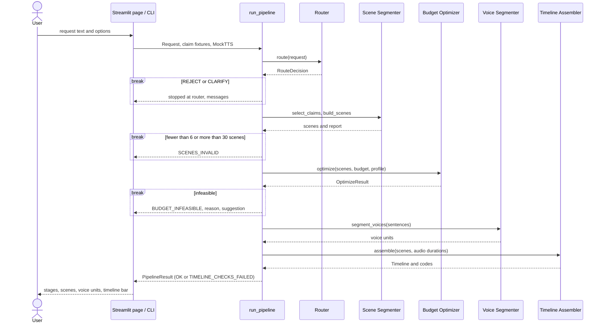
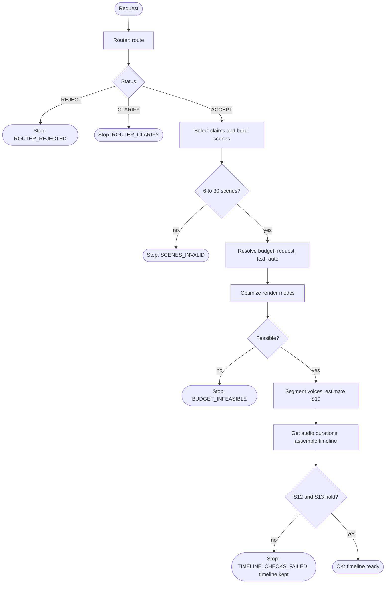

# Design artifacts – Pipeline demo (Lab04)

Chosen from the Lab04 list: user story, sequence diagram, activity diagram (written in Mermaid).
The other artifacts (use case, state machine, package, deployment, ERD, C4) were left out on purpose:
the feature has one actor, no persistent state and no database.

## 1. User story
**As a** user of StoryFrame Studio, **I want** to type one request and see the planned video or the reason it cannot be built, **so that** I know whether to change the request.

Acceptance: see `spec.md` scenarios 1–10.

## 2. Sequence diagram

## 3. Activity diagram

